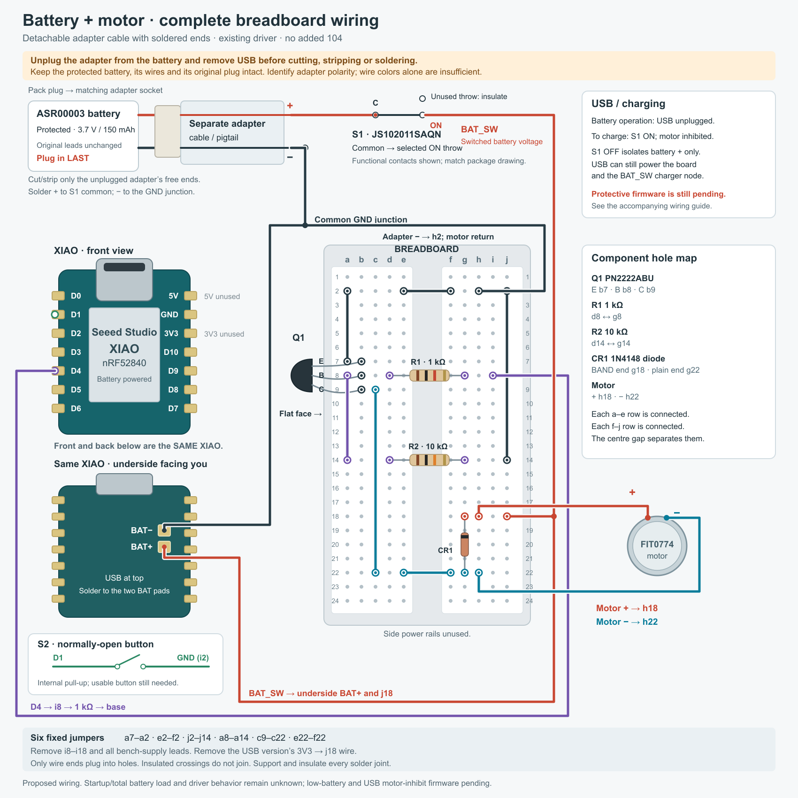
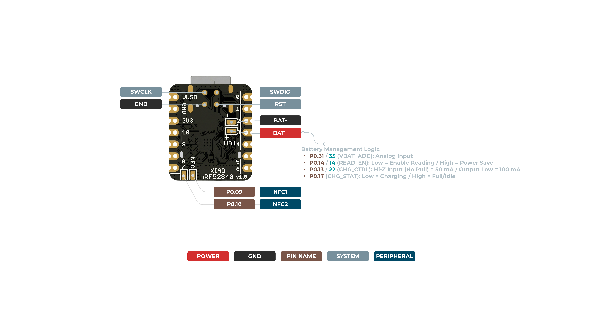

# Battery adapter and motor wiring

**Superseded by the user's clarification:** there will be no separate adapter. Use the [direct battery-lead diagram](BATTERY_DIRECT_WIRING.md) for the current requested wiring. This page preserves the earlier detachable-adapter option only.

Additional battery-powered option requested November 10, 2026. The [USB-only diagram](USB_MOTOR_MVP.md) remains a separate option. This is a complete connection proposal using the existing battery, motor, driver, resistors and slide switch, with no added 104 capacitor. It is not a physical qualification or a firmware upload.

**Adapter assumption:** a separate, detachable mating cable/pigtail. Unplug it from the battery before cutting its free ends, stripping or soldering. Keep the protected ASR00003 pack, its attached leads and its original connector intact. TinyCircuits prohibits modifying the pack and directly soldering its terminals. If “adapter” means the TinyLily ASL1201 board, use its VCC and GND solder holes; cutting that board is unnecessary. The exact adapter the user has remains unidentified. [Battery handling instructions, p.9](https://files.tinycircuits.com/Datasheets/ASR00003_150mAh.pdf), [TinyLily adapter](https://tinycircuits.com/products/tinylily-battery-adapter).

[Open scalable diagram](images/battery-adapter-motor-breadboard.svg) · [Connection schedule](battery-adapter-motor.connections.json)

## Complete connections

| From | To |
| --- | --- |
| Battery's original plug | Matching detachable adapter socket |
| Adapter protected positive | S1 common contact |
| S1 selected ON throw | Breadboard **j18** and XIAO underside **BAT+** |
| S1 unused throw | Unconnected and insulated |
| Adapter protected negative | Common GND junction, branching to **h2** and XIAO underside **BAT−** |
| XIAO D4 | **i8**, then existing 1 kΩ to Q1 base |
| Motor positive | **h18** |
| Motor negative | **h22** |
| Normally-open button | XIAO D1 ↔ button ↔ **i2 (GND)** |
| XIAO 3V3 and 5V | Unconnected in this battery configuration |

`BAT_SW` is the switched battery-voltage junction, not regulated 3.3 V. Motor power runs from BAT_SW through the motor and transistor to the battery-return junction. Motor current does not come from a GPIO or the XIAO 3V3 pin. For soldered construction, each breadboard net becomes an insulated, mechanically supported junction with the same connections; the circuit does not change.

Keep the driver placement from the USB diagram:

| Part | Holes |
| --- | --- |
| PN2222ABU | E **b7**, B **b8**, C **b9** |
| 1 kΩ | **d8–g8** |
| 10 kΩ | **d14–g14** |
| 1N4148 | Banded cathode **g18**; plain anode **g22** |
| Six fixed jumpers | **a7–a2**, **e2–f2**, **j2–j14**, **a8–a14**, **c9–c22**, **e22–f22** |

Remove the USB-only version's **3V3–j18** wire, the temporary **i8–i18** ON jumper and all bench-supply leads. The side power rails remain unused. Keep the diode/motor loop short and support the slide switch and solder joints.

The switch diagram shows functional common/throw contacts; it does not assign physical left/right legs by appearance. Match the exact JS102011SAQN package drawing. Adapter polarity/continuity, mounting and the actual board revision remain identification/assembly unknowns; published component ratings are accepted without re-testing. [C&K drawing, p.4](https://www.ckswitches.com/media/1422/js.pdf).

## XIAO solder pads

The diagram shows the front and underside of **one XIAO**, not two boards. With the underside facing you and USB at the top, Seeed's official back pinout shows the battery pads near the right edge: **BAT− above BAT+**. These are the two rectangular battery pads, separate from the edge GPIO contacts. Match the BAT markings on the actual board and the applicable revision before soldering; do not mirror the front view. [Official back pinout](https://files.seeedstudio.com/wiki/XIAO-BLE/XIAO_nRF52840_back_pinout.png), [Seeed board documentation](https://wiki.seeedstudio.com/XIAO_BLE/).

## Power modes and unresolved limits

| Mode | Connections and behavior |
| --- | --- |
| Battery operation | Battery connected, S1 ON, USB unplugged |
| Battery OFF | S1 OFF isolates pack positive from board and motor |
| Charging | S1 ON and USB attached; use nominal 50 mA mode and inhibit motor |
| USB with S1 OFF | Board still powers from USB; battery does not charge; onboard charger can energize BAT_SW |
| Soldering / changes | Battery physically unplugged and USB removed |

The USB charging statements follow the published power-path topology; the exact board revision still needs identification. USB motor inhibition is a firmware policy, not a hardware interlock. See the [official schematic](https://files.seeedstudio.com/wiki/XIAO-BLE/Res/260828_XIAO_nRF52840.pdf) and the [existing product analysis](PRODUCT_CIRCUIT.md).

The USB-only test build permits an explicit manual motor test with the battery absent; automatic motor feedback remains disabled. Battery use still needs low-battery cutoff, bounded product feedback and USB motor inhibition, including wall chargers. Use the documented nominal 50 mA charging configuration and battery-read controls; the stock circuit has no pouch-temperature sensing. This drawing did not release portable firmware; see [USB test status](USB_MOTOR_MVP.md) for the separate USB-only work.

True remaining hardware unknowns: actual startup/total battery demand, loaded transistor behavior, exact diode identity/suitability and behavior of this assembly without an added capacitor. The battery's specified 150 mA maximum discharge remains the limit; its protection is not a 150 mA current limiter. No noise-caused failure has been observed, and no capacitor requirement is established for FIT0774. The usable physical button and actual adapter availability remain unresolved. See [PRODUCT_CIRCUIT](PRODUCT_CIRCUIT.md) and [MOTOR_RESEARCH](MOTOR_RESEARCH.md) for the existing manufacturer-backed limits and unknown-only checks.
