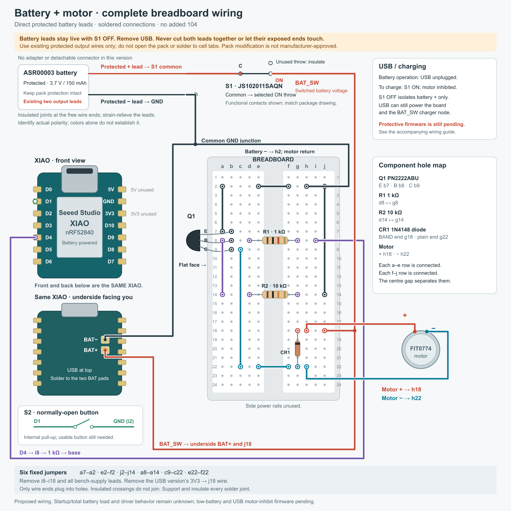

# Direct battery-lead wiring with motor

Latest clarification, November 10, 2026: use the **two existing output wires attached to the protected ASR00003 battery**, soldered into the circuit, with **no separate adapter or detachable connector**. This replaces the adapter assumption in the previous diagram. The motor driver and breadboard positions remain the same; no added 104 capacitor is specified.

This drawing describes electrical destinations. It is not a claim that modifying this pack is manufacturer-approved: TinyCircuits says not to modify the battery or directly solder the pack/battery terminals. The connection shown uses its existing insulated **protected output leads**, preserving the protection circuit; it does not call for opening the pouch, soldering cell tabs or bypassing protection. [Manufacturer handling instructions, p.9](https://files.tinycircuits.com/Datasheets/ASR00003_150mAh.pdf).

[Open scalable diagram](images/battery-direct-motor-breadboard.svg) · [Exact connection schedule](battery-direct-motor.connections.json)

## Complete power and input connections

| From | To |
| --- | --- |
| Battery's existing protected **positive wire** | S1 common contact |
| S1 selected ON throw | **j18**, plus a branch to XIAO underside **BAT+** |
| S1 other throw | Unconnected and insulated |
| Battery's existing protected **negative wire** | Common GND junction, branching to **h2** and XIAO underside **BAT−** |
| XIAO D4 | **i8**, then the existing 1 kΩ resistor to Q1 base |
| Motor positive | **h18** |
| Motor negative | **h22** |
| Normally-open button | XIAO D1 ↔ button ↔ **i2 (GND)** |
| XIAO 3V3 / 5V | Unconnected in this version |

S1 switches battery positive to both board BAT+ and motor power. `BAT_SW` is this switched battery-voltage junction, not regulated 3.3 V. All grounds are common. Motor current follows battery positive → S1 → motor → Q1 → battery negative; it is not supplied by a GPIO or the XIAO 3V3 regulator. Keep the motor return connected directly to the battery-return junction as drawn.

## Existing driver placement

| Part | Breadboard holes |
| --- | --- |
| PN2222ABU | E **b7**, B **b8**, C **b9** |
| 1 kΩ | **d8–g8** |
| 10 kΩ | **d14–g14** |
| 1N4148 | Banded cathode **g18**; plain anode **g22** |
| Six fixed jumpers | **a7–a2**, **e2–f2**, **j2–j14**, **a8–a14**, **c9–c22**, **e22–f22** |

Remove the USB-only **3V3–j18** wire, temporary **i8–i18** jumper and all bench-supply leads. The side power rails remain unused. The switch drawing identifies functional common/ON contacts; match the actual JS102011SAQN manufacturer package drawing rather than inferring leg positions from the illustration. [C&K drawing, p.4](https://www.ckswitches.com/media/1422/js.pdf).

Front and underside views in the diagram show **one XIAO**. With its back facing you and USB at the top, the official back pinout shows **BAT− above BAT+** near the right edge. They are the two small rectangular battery pads, separate from the edge GPIO contacts. Match the actual board markings/revision before soldering. [Official back pinout](https://files.seeedstudio.com/wiki/XIAO-BLE/XIAO_nRF52840_back_pinout.png).

## Assembly and operating limits

With this permanent connection, the battery leads remain live when S1 is OFF. OFF disconnects only the downstream positive branch. Remove USB for assembly; never cut both battery wires together or allow exposed ends to touch. Keep the other conductor insulated while working on a lead; individually insulate and support completed joints, and keep heat away from the pouch/protection board. Opening the pack or soldering its cell tabs is outside this drawing. Once installed, the battery cannot be unplugged for servicing; S1 OFF is not complete electrical isolation.

Battery operation uses S1 ON with USB unplugged. Charging uses S1 ON and the XIAO's USB socket, nominal 50 mA charging configuration and motor inhibition. With S1 OFF, USB still powers the XIAO and can energize BAT_SW through the onboard charger; the battery does not charge through the open switch. These are power-path consequences, not a hardware motor interlock. [Seeed board documentation](https://wiki.seeedstudio.com/XIAO_BLE/), [published schematic](https://files.seeedstudio.com/wiki/XIAO-BLE/Res/260828_XIAO_nRF52840.pdf).

The USB-only test firmware permits an explicit manual motor test; automatic motor feedback remains disabled. Use this test build with the battery absent. Battery use still needs low-battery cutoff, bounded product feedback and USB motor inhibition including wall chargers. Stock circuitry has no pouch-temperature sensing. This drawing did not perform battery cuts, soldering or a portable firmware release; see [USB test status](USB_MOTOR_MVP.md) for the separate USB-only work.

The existing unresolved limits remain: startup/total battery load, loaded transistor behavior, actual diode identity/suitability, board revision and real assembly behavior without an added capacitor. The battery's specified 150 mA maximum discharge is accepted without re-testing; its protection is not a 150 mA current limiter. No motor-noise failure has been observed. A usable physical button is still needed. See [PRODUCT_CIRCUIT](PRODUCT_CIRCUIT.md) and [MOTOR_RESEARCH](MOTOR_RESEARCH.md) for manufacturer limits and unknown-only checks.
