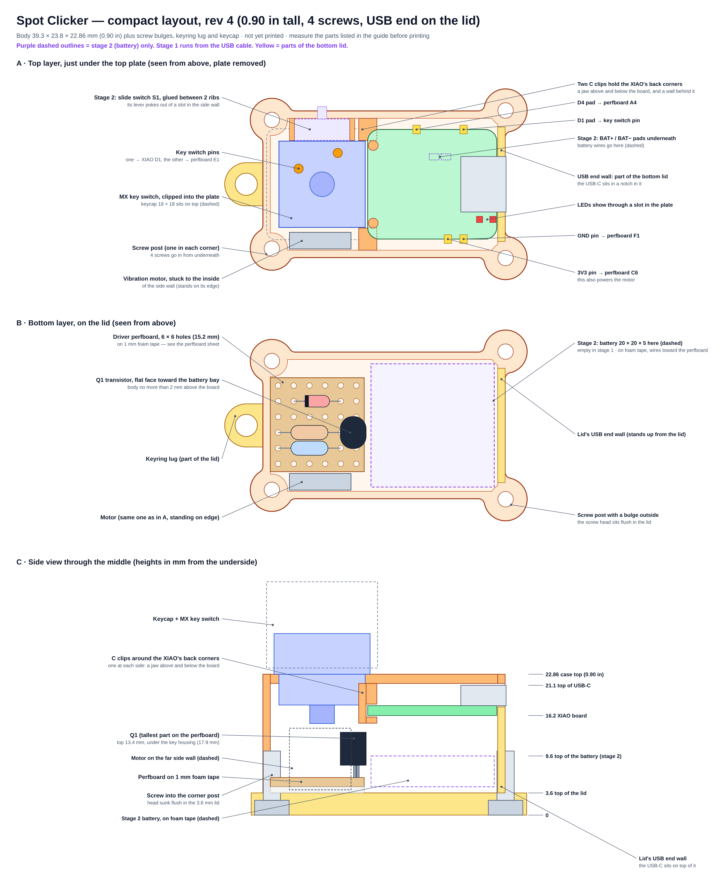
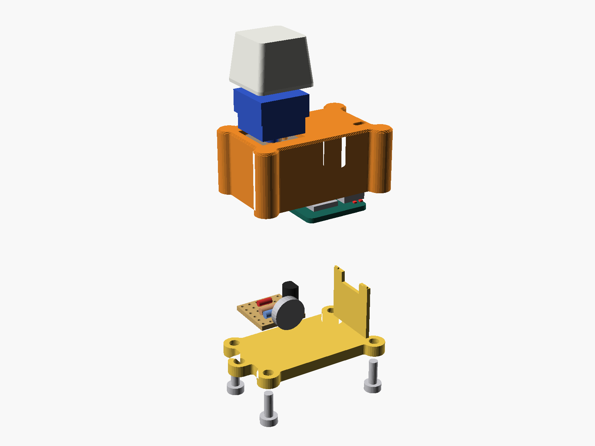
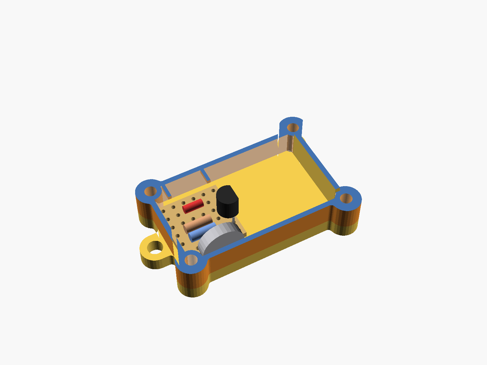
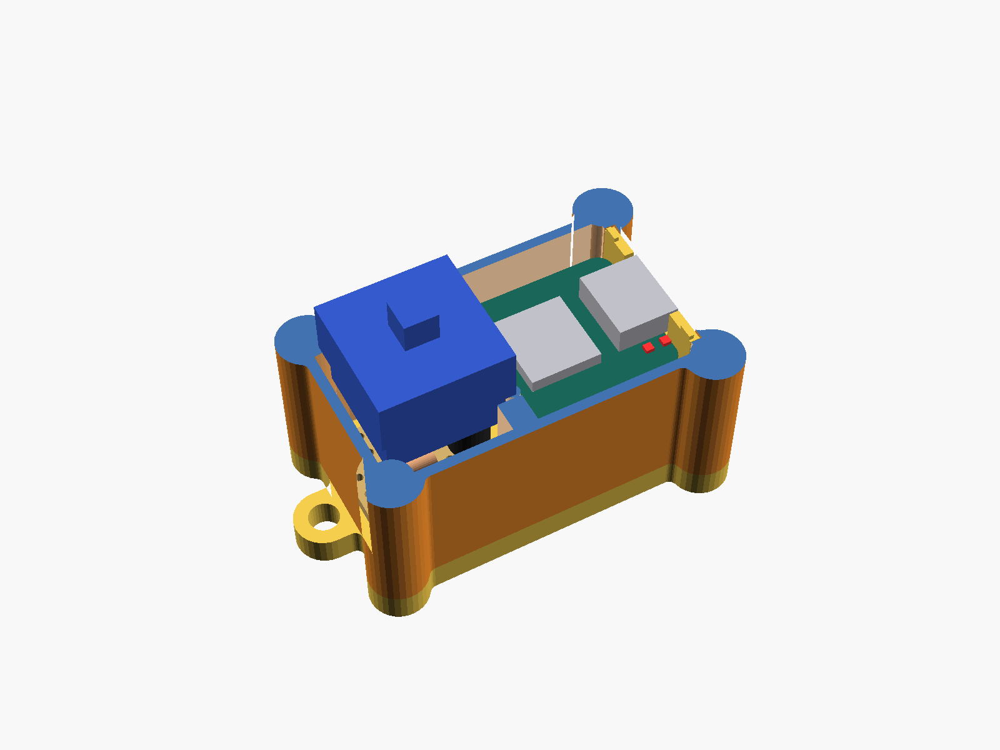
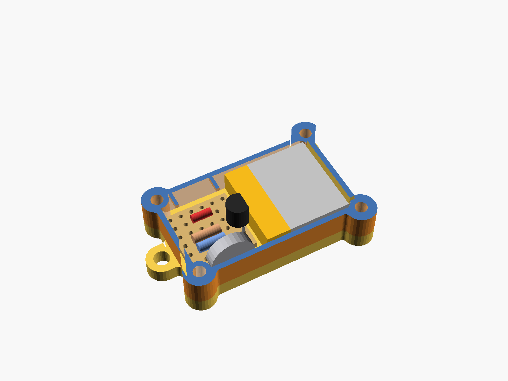
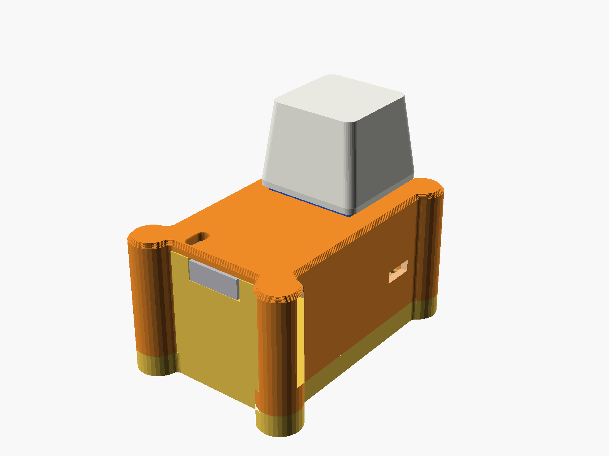
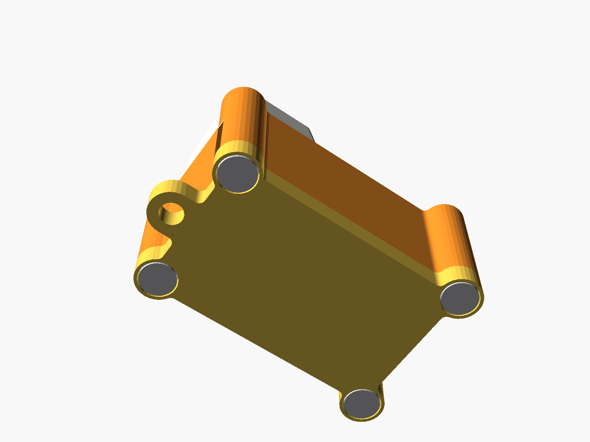
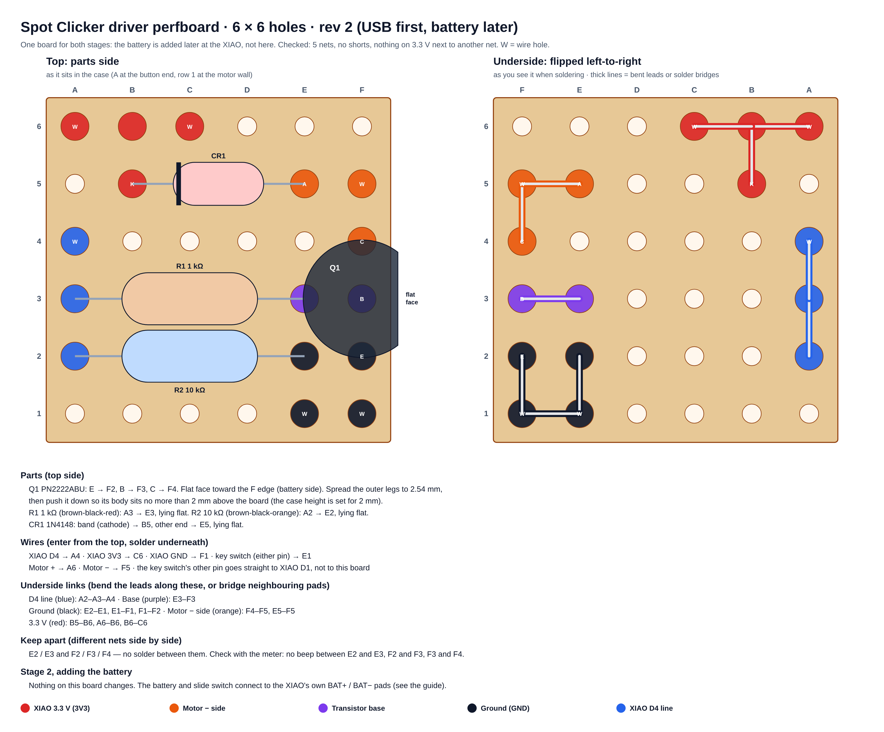
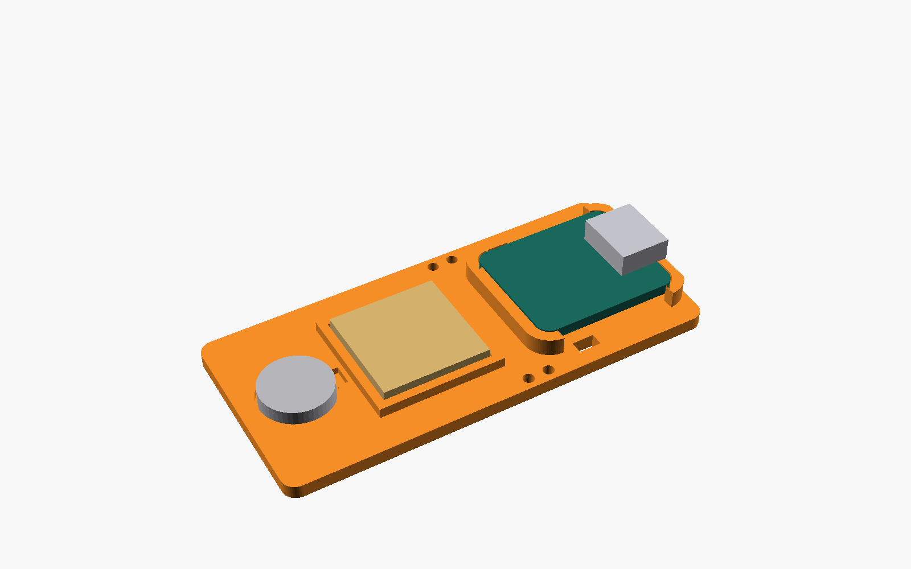

# Compact enclosure and layout — rev 4: 0.90 in tall, 4 screws, two printed parts

November 17, 2026 · Claude. **This design has not been printed or built yet.**

- **Stage 1, now:** the clicker runs from the USB cable. The battery's space stays empty, and the slide switch isn't fitted.
- **Stage 2, later:** take the lid off, stick the battery to the lid, then add the slide switch and three wires at the XIAO. Nothing is reprinted, and the perfboard doesn't change.
- **Body:** 39.3 × 23.8 × 22.9 mm (0.90 in tall). Four round screw bulges stick out at the corners, so it measures 44.9 × 31.0 mm across them. The keyring lug and the keycap come on top of that.
- **Printed parts:** just two, the case and the bottom lid, about 11 g of PLA.
- **Closing:** 4 of your screws (0.22 in head, 0.11 in thread, 0.40 in long) hold the bottom lid on. The USB end wall is part of the lid.
- **Circuit:** the same as Codex's [USB_PERFBOARD_MVP](USB_PERFBOARD_MVP.md) with its B1–C1 link fitted. The motor runs from the XIAO's 3V3 pin through the transistor in both stages. The board layout is different so that it fits under the key; see [Why a different board layout](#why-a-different-board-layout).
- **Files:**
  - Model: [`cad/spot_clicker_compact.scad`](../cad/spot_clicker_compact.scad), for OpenSCAD.
  - Print files: [`cad/stl/`](../cad/stl/).

| | |
| --- | --- |
|  |  |
|  |  |
|  |  |

## Changes in rev 4

- **0.90 in (22.9 mm) tall**, up from 0.80 in in rev 3 (16.3 mm in rev 2). There is now:
  - 4.4 mm between the transistor and the key switch.
  - 6.6 mm for wires between the battery and the XIAO.
- **Wider screw holes in the posts:** 2.8 mm, up from 2.5 mm, which printed too tight.
- **Only two printed parts.** The separator plate, the battery stand-in block and the stop rib on the lid are gone. The C clips hold the XIAO without them.

## Changes in rev 3

- **Screws instead of the snap lid.** Rev 2's lid needed an accurate printer. Now 4 screws go in from underneath, into posts at the corners. The posts bulge out of the case, and the screw heads sit flush in the 3.6 mm lid.
- **The screws cut their own thread.** The holes in the posts are printed plain, no bigger than the screw. Printed threads this small don't come out well on most printers.
- **The USB end wall is part of the lid.** With the lid off, the USB end of the case is open, so the XIAO slides in without forcing its USB-C through a hole.
- **C clips hold the XIAO.** The two stops behind the XIAO are now C clips. Each one has a jaw above and a jaw below a back corner of the XIAO, with a wall behind it, so the XIAO can't lift or slide back.
- **Keyring lug** is now part of the lid.
- **Motor and slide switch moved** toward the USB end (0.7 mm and 2 mm) to clear the screw posts.
- **Slide-switch ribs** now run up to the top plate, so they print without hanging in mid-air.

## How it is arranged

| Layer | Button end (X = 0–17 mm) | USB end (X = 17–39 mm) |
| --- | --- | --- |
| **Top, under the plate** | The key switch, clipped into the 1.5 mm plate. In stage 2, the slide switch sits between two ribs with its lever out through the side wall. | The XIAO, parts facing up. Two C clips hold its back corners, its USB-C sits in a notch in the lid's end wall, and its LEDs show through a slot in the plate. |
| **Bottom, on the lid** | The 6 × 6-hole driver perfboard, on 1 mm foam tape. The motor stands on its edge, stuck to the side wall. | Stage 1: empty. Stage 2: the battery on foam tape, wire end toward the perfboard. |
| **Corners** | Two screw posts, inside the case corners. | Two screw posts, just outside the corners, because the battery fills the case wall to wall. |

The transistor's top stays 4.4 mm below the key switch housing. The OpenSCAD file stops with an error if a change breaks that. Checks on the model found:
- no overlaps between any two parts, in either stage
- nothing in the way when the XIAO slides into its clips

## Why a different board layout

Codex's 5 × 6 layout works electrically, but its transistor sits in the middle of the board. Under the key, that puts it right below the key switch's centre post, so the case would need to be about 3 mm taller.

This 6 × 6 layout puts the transistor at the board's edge, beside the post. The connections are the same except for R2; see the end of this doc.

## Stage 1: build for USB

### 1. Build and check the perfboard

Cut a 6 × 6-hole piece (about 15.2 × 15.2 mm) from your 19 mm strip. The parts, wires and underside links are all on the sheet. The layout was checked:
- 5 nets, no shorts.
- No pad on 3.3 V sits next to a pad of another net.

Before you wire it to the XIAO, use the meter's continuity mode. There should be:
- No beep between C6 (3.3 V) and F1 (ground).
- No beep between E2 and E3, F2 and F3, or F3 and F4.

### 2. Measure, then print

Type each value into OpenSCAD's Customizer under "Measure these", then export again.

1. **Battery length × width × thickness.** The datasheet allows ±3 / ±2 / ±0.5 mm. The battery's space is printed now, so measure it now.
2. **XIAO thickness at the USB-C.** Subtract 1.6 mm (the board) to get `usb_h`.
3. **Transistor height above the board (`q_lift`)**, after you solder it. The case is set for 2 mm.
4. **Slide-switch body height**, from its pin face to its lever face (`s1_h`). The listings give 9 × 3.5 mm but no height.

**If you want to check the fit first,** print `spot_clicker_fit_test.stl`. It is the top 8.5 mm of the case and takes about 25 minutes. Check that:
- the key switch clicks into the plate
- the keycap moves freely
- the XIAO slides into its two C clips
- the LED slot sits over the LEDs

**Then print the two parts.** They are already oriented, so they need no supports:
- `top_shell`, plate down on the bed
- `floor_lid`, flat, with its end wall standing up

To print them in one go, open `spot_clicker_print_set.stl` instead: both parts already laid out on one 49 × 66 mm plate.

**Settings:** 0.2 mm layers, 3 walls, 20–30 % infill. With 3 walls the screw posts print solid around their holes.

If the XIAO is too tight in its clips, raise `xiao_fit` (0.25 mm now) and export again.

### 3. Wire it (28–30 AWG, keep wires short)

| From | To |
| --- | --- |
| XIAO D4 (edge pad) | Perfboard A4 |
| XIAO 3V3 (edge pad) | Perfboard C6 |
| XIAO GND (edge pad) | Perfboard F1 |
| Key switch, either pin | XIAO D1 (edge pad) |
| Key switch, other pin | Perfboard E1 |
| Motor + / motor − | Perfboard A6 / F5 |

- Solder the key-switch wires close to the switch body, then trim the pin ends.
- Run each XIAO wire along the XIAO's nearest long edge, in the gap under it, and bring it down at the corner nearest the key. Don't run wires across the middle of that end, where the antenna is.

### 4. Put it together

1. Turn the shell upside down and clip the key switch in from the top.
2. Lay the XIAO in, parts toward the plate, with its USB-C sticking out about 2 mm past the open end. Slide it toward the key until both back corners are in the C clips.
3. Stick the motor to its wall.
4. Stick the perfboard to the lid with foam tape.
5. Put the lid on. Its end wall goes into the open end, with the USB-C in its notch and the two tabs on top in the slots under the plate.
6. Fit the 4 screws from underneath:
   - The first time, each screw cuts its own thread, so it turns stiffly. Keep it straight.
   - Stop when the head is flush with the lid. Tightening further strips the plastic thread.
   - If a screw spins without biting, put a dab of glue in the hole and let it set before you screw it in again.

The slide switch's slot stays empty in stage 1. Cover it with tape if you like.

### 5. Test on USB

Plug in USB and run the checks in [USB_PERFBOARD_MVP](USB_PERFBOARD_MVP.md): tap, double-tap and hold should send the right actions, then run the `m` motor test. Also check that:
- the USB-C plug seats fully
- the XIAO doesn't move when you push the cable in or pull it out

## Stage 2: add the battery

1. Unplug USB and take out the 4 screws. Lift the lid off; the USB end wall comes with it, and the XIAO stays in its clips.
2. Find the slide switch's ON pin. With the meter, check which outer pin connects to the middle pin when the lever is in your "on" position. Leave the third pin unconnected and insulate it.
3. Solder these, in this order:

   | From | To |
   | --- | --- |
   | Slide switch ON pin | XIAO BAT+ pad (underside) |
   | Battery − lead | XIAO BAT− pad (underside) |
   | Battery + lead, last, with the switch off | Slide switch middle pin |

   - The two BAT pads are 1.9 mm apart, so keep the joints small.
   - The battery's leads stay live even with the switch off. Cut and strip them one at a time, following the handling notes in [BATTERY_DIRECT_WIRING](BATTERY_DIRECT_WIRING.md).
4. Put a piece of tape over the two BAT joints under the XIAO, so the battery can never press on them.
5. Glue the slide switch between its ribs, with the lever through the slot.
6. Stick the battery to the lid with foam tape, wire end toward the perfboard, leaving about 1 mm between them.
7. Put the lid on and fit the screws. Turn each one backward first until you feel it drop into the thread it cut before, then tighten until the head is flush.

Before you carry it around:
- The battery firmware work in Codex's notes still applies: low-battery cutoff and charging behaviour.
- Charge with the slide switch on.

## Bench holder, while you develop

[`cad/spot_clicker_bench_holder.scad`](../cad/spot_clicker_bench_holder.scad) and `cad/stl/spot_clicker_bench_holder.stl` hold the XIAO, the perfboard and the motor on one 61 × 28 mm base. Use it until the parts go into the case, so plugging USB in and out can't jerk the XIAO around on its wires.

- The XIAO sits parts-up between two end frames. The back frame takes the push of plugging in, and the frame under the USB-C takes the pull of unplugging.
- A small zip tie or rubber band through the two slots goes over the XIAO's metal shield and holds it down.
- The perfboard sits in its pocket on 1 mm foam tape, and the motor's own sticky pad holds it in the round recess.
- Tie or tape each wire at the holes between the perfboard and the XIAO, with a little slack, so a tug pulls on the tie and not on the solder joint.

Print it flat, with no supports, using the same settings as the case.

## Still to test

- **Bluetooth range.** Test in stage 1, then in stage 2 with the battery under the XIAO's antenna end. Test with the phone in a pocket.
- **Motor strength on the battery** (stage 2), as the battery runs down. The motor shares the XIAO's 3.3 V supply, which sags when the battery gets low.
- **Screw threads in PLA:** how many times the lid can come off before the threads wear.

## Change from Codex's circuit

R2 (10 kΩ) pulls the **D4 line** to ground instead of the base. It does the same job: Q1 stays off while D4 floats during reset or upload. It keeps this layout short and adds 0.33 mA to the D4 load:
- typical: about 2.8 mA
- worst case: 3.8 mA

Both are below the 5 mA high-drive point. The base current is unchanged.

## Sizes used

| Part | Size used | Source |
| --- | --- | --- |
| XIAO | 20.96 × 17.78 mm board, 1.6 mm thick. USB-C body 9.0 × 7.35 mm, 1.5 mm past the board edge. LED and pad positions. | Seeed v1.2 KiCad files |
| MX switch | 15.63 mm housing; 18.5 mm total height | CHERRY MX2A datasheet |
| MX plate | 14.0 × 14.0 mm cutout; 1.5 mm plate; 5 mm from plate top to PCB | ai03 plate guide (community standard). Cherry's sheet doesn't list it. |
| Motor | Ø10 × 2.7 mm | DFRobot FIT0774 |
| TO-92 transistor | 5.20 wide × 5.33 tall × 4.19 deep, maximum | onsemi PN2222A drawing |
| Transistor lift | Body 2 mm above the board | My estimate for legs spread to 2.54 mm. Measure yours (`q_lift`). |
| Resistors | 6.0 ± 0.3 × Ø2.3 ± 0.3 mm | Stackpole CF14 |
| Diode | ≤ 4.56 × Ø1.91 mm | onsemi DO-35 |
| Battery | 20 ± 3 × 20 ± 2 × 5.0 ± 0.5 mm | TinyCircuits ASR00003 drawing |
| Slide switch | 9 × 3.5 mm body; 2.0 mm lever | LCSC and DigiKey listings for C&K JS102011SAQN |
| Screws | 5.6 mm (0.22 in) head, up to 2.4 mm tall; 2.8 mm (0.11 in) thread; 10.4 mm (0.40 in) long overall | Raj's measurements; head height assumed |
| Screw holes | Posts 2.8 mm (2.5 mm printed too tight). Lid: 3.4 mm, with 6.0 mm × 2.4 mm deep pockets for the heads. | Model |
