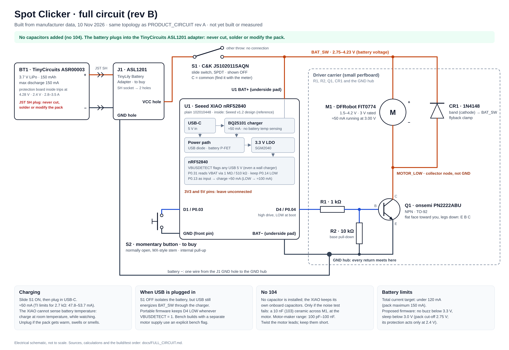

# Spot Clicker full circuit — rev B

Checked against manufacturer documents on November 10, 2026. **This is a proposal. It has not been built or measured.** It uses the same parts, values and pins as [PRODUCT_CIRCUIT](PRODUCT_CIRCUIT.md) rev A, which was written separately. Rev B adds four things: a battery adapter, the XIAO's underside pads identified from Seeed's own PCB file, the motor maker's capacitor guidance, and concrete firmware safety rules.

> **Update, November 10 (late):** build in two stages instead, USB first and battery later ([COMPACT_ENCLOSURE](COMPACT_ENCLOSURE.md) rev 2, [USB_PERFBOARD_MVP](USB_PERFBOARD_MVP.md)). In both stages the motor runs from the XIAO's 3V3 pin, not from BAT_SW. The battery's own protected leads are soldered in directly ([BATTERY_DIRECT_WIRING](BATTERY_DIRECT_WIRING.md)), so J1 isn't needed. The driver values, ratings and firmware rules below still apply; powering the motor from BAT_SW is now a later option.

[Scalable schematic](images/full-circuit.svg) · [Bench driver stage](BREADBOARD_LAYOUT.md) · [Next physical step](TRANSISTOR_BENCH_TEST.md)

## Still needed

| Item | Why | Status |
| --- | --- | --- |
| TinyCircuits TinyLily Battery Adapter (ASL1201) | Its JST SH socket mates with the pack, and it has two solder holes marked VCC and GND. The pack must not be cut or soldered. | **To buy.** $3.95; ships from Akron, OH in 1–2 business days [T2] |
| Normally-open momentary switch with an MX-style stem, e.g. CHERRY MX2A Blue | The keychain's original contacts can't be reached | **To buy.** Check that the stem fits the keycap [C1] |
| Small perfboard piece, about 10 × 15 mm | Holds R1, R2, Q1, CR1, the motor wires and the GND hub | Buy, or use scrap |
| 28–30 AWG silicone wire in two colors, 1.5–2 mm heat-shrink, Kapton tape | Short insulated wires; insulation for the adapter's back and the pack's edges | Buy |
| Rosin-core solder and flux; a soldering iron; a multimeter with continuity, DC volts and mA ranges | Assembly and checks | Borrow ([BUILD_PLAN](BUILD_PLAN.md)) |
| Thin double-sided tape | Mounts the motor to a rigid case wall, not to the pack | Buy |
| One 10 nF (103) ceramic capacitor, rated 10 V or more | Contingency, only if the noise test fails | **Don't buy yet** |

Already on hand: XIAO nRF52840, ASR00003 pack, FIT0774 motor, JS102011SAQN switch, PN2222ABU, 1N4148, 1 kΩ and 10 kΩ resistors, and the U8031A supply.

## Connections

Net names used below:
- `BAT_SW`: battery positive after S1.
- `MOTOR_LOW`: the collector node. It is switched, not ground.
- GND hub: one pad on the carrier where every return wire meets.

XIAO pin positions assume USB at the top and components facing you.

| # | From | To |
| --- | --- | --- |
| 1 | Pack plug | J1 socket (keyed) |
| 2 | J1 VCC hole | S1 common (C) |
| 3 | S1 ON throw | Carrier BAT_SW pad |
| 4 | S1 other throw | Nothing; insulate it |
| 5 | Carrier BAT_SW pad | XIAO BAT+ underside pad, M1 + lead, CR1 band (cathode) |
| 6 | J1 GND hole | Carrier GND hub (one wire) |
| 7 | Carrier GND hub | XIAO BAT− underside pad, Q1 E, lower end of R2 |
| 8 | XIAO D4 (left edge, 5th pin) | R1 → Q1 B |
| 9 | Q1 B | Upper end of R2 |
| 10 | Q1 C | MOTOR_LOW: M1 − lead and CR1 anode |
| 11 | XIAO D1 (left edge, 2nd pin) | S2, one contact |
| 12 | XIAO GND (right edge, 2nd pin) | S2, other contact |
| 13 | XIAO 3V3 and 5V pins | Nothing |

Motor current runs BAT_SW → M1 → Q1 → GND hub → J1, so it never passes through the XIAO.

Checks to do before soldering:
- **XIAO underside pads.** Seeed's v1.2 PCB file has two battery pads on the underside, 1.9 mm apart: one on VBAT and one on GND [S2]. In continuity mode, the BAT− pad beeps to the front GND pin and BAT+ does not.
- **J1 polarity.** TinyCircuits' design files print VCC and GND beside the holes [T3]. With the pack plugged into J1, put the red probe on VCC and the black probe on GND. The meter should read 3.0–4.2 V, positive. A negative reading means stop.
- **S1 terminals.** The C&K drawing has terminals 1, C and 3 [K1]. Use continuity to find which outer terminal connects to C in the ON position.
- **Q1 and CR1 orientation.** For Q1, with the flat face toward you and the legs down, the order is E B C [O1]. CR1's band is the cathode [O2].
- **Wiring layout.** Twist the two motor wires and keep them short. Keep the motor, its wires and the pack away from the end of the XIAO opposite the USB-C port, where Seeed places the chip antenna [S2].

## Safety rules

1. **Never cut, solder or modify the pack**, and never reverse its polarity [T1].
2. **Build unpowered.** Unplug the pack and USB, and set S1 OFF. Plug the pack in last.
3. **Check for shorts before first power**, with the pack unplugged:
   - There must be no continuity from BAT_SW to GND, to any D pin, or to 3V3. A GPIO's absolute maximum is VDD + 0.3 V [N2].
   - A resistance reading that rises slowly is the XIAO's capacitors charging, not a short.
4. **Insulate.**
   - Put heat-shrink on every joint.
   - Put Kapton over the adapter's back and between the pack and anything sharp or conductive. The datasheet requires insulation at the pouch's exposed aluminum edge [T1].
   - Don't press, pierce or bend the pack.
5. **Charge only attended and at room temperature**, with S1 ON and USB plugged in.
   - The pack datasheet gives no charging temperature range; its standard test condition is 23 ± 5 °C [T1].
   - The XIAO's charger has TS tied to a fixed 10 kΩ [S2], which TI describes as having no NTC sensing [TI1].
   - Unplug if the pack gets warm, swells or smells [T1].
6. **Keep charging at about 50 mA** by leaving P0.13 as an input.
   - The calculated range is 47.8–53.7 mA, from TI's KISET and Seeed's 2.7 kΩ [TI1, S2]. The pack's standard charge is 75 mA and its maximum is 150 mA [T1].
   - Driving P0.13 LOW would give 95.6–107.4 mA [S1, TI1].
7. **Keep P0.14 LOW at all times.** Otherwise P0.31 can exceed its limit [S1]. With P0.14 LOW, P0.31 sees at most 1.43 V (calculated).
8. **Keep the motor off whenever USB power is present.**
   - With S1 OFF, BAT_SW is fed only by the charger. With no battery attached, the charger runs a battery-detect routine that pulls OUT below regulation and sinks about 2 mA, continuously [TI1]. That is not a motor supply.
   - Use the nRF52840's POWER.USBREGSTATUS.VBUSDETECT bit [N3]. It depends only on VBUS voltage, so it also catches wall chargers, and Seeed wires VBUS to the chip [S2].
9. **Stop before the battery runs too low.**
   - The pack's protection disconnects only at 2.4 ± 0.1 V, below its 2.75 V discharge cut-off [T1].
   - Proposed firmware thresholds: no buzz below 3.3 V, and System OFF below 3.0 V.
   - Store the clicker with S1 OFF at 40–60 % charge, and top it up every 3 months [T1].
10. **Stay within the current rating.** The pack's maximum discharge is 150 mA, but its protection trips only at 2.8–3.5 A [T1], so nothing stops an overload between those values. Target: measured total under 120 mA, including motor start.
11. **Bench supply and meter.**
    - Never connect the bench supply and the pack at the same time.
    - Never put the meter in current mode across the pack.

## Ratings check

Calculated with VDD 3.3 V, VBE 0.8 V typical and 1.2 V worst (onsemi VBE(sat) max), and 5 % resistors. Motor current is 50 mA measured at 3.00 V; it is estimated at 69 mA at 4.23 V, assuming current scales with voltage.

| Part | Worst case here | Manufacturer limit |
| --- | --- | --- |
| Q1 collector current | about 69 mA running (estimate); start current unknown | 1.0 A [O1] |
| Q1 off-state VCE | ≤ 4.23 V + diode drop | 40 V [O1] |
| Q1 dissipation | ≤ 25 mW | 625 mW [O1] |
| D4 source current | 2.4 mA typical; 3.5 mA even with the base shorted | High-drive VOH specified at 5 mA [N1] |
| CR1 reverse voltage | ≤ 4.23 V | 100 V [O2] |
| CR1 forward current | brief, no more than the motor current at turn-off | 300 mA DC; 1 A surge for 1 s [O2] |
| R1 / R2 power | ≤ 11.5 mW / 0.15 mW | 250 mW [P1] |
| S1 contacts | about 91 mA estimated total | 0.3 A at 6 VDC [K1] |
| S2 contacts | 0.3 mA at 3.3 V | 10 mA at 12 V [C1] |
| M1 voltage | ≤ 4.18 V (4.23 V − VCE) | 1.5–4.2 V operating [D1] |
| Pack discharge | about 91 mA estimated running | 150 mA maximum [T1] |
| Pack charge | 47.8–53.7 mA at 4.16–4.23 V | 150 mA maximum; protection trips at ≥ 4.255 V [TI1, T1] |

The 1 kΩ base drive gives a forced gain of 21–46. That is below onsemi's minimum hFE of 50 at 150 mA and 1 V, so saturation is likely. It is not guaranteed: onsemi only specifies VCE(sat) ≤ 0.3 V at a 10:1 drive (150 mA / 15 mA) [O1]. **Measure VCE; the target is ≤ 0.3 V.**

If VCE fails at 3.0 V, change R1 to 820 Ω. That is a new part, and the worst-case GPIO current becomes 4.2 mA, still under the 5 mA high-drive point.

The proposed 3.3 V no-buzz rule also keeps the driver away from its weakest point. Near a 2.75 V battery, the worst-case base current falls to about 0.9 mA.

## Why there is no 104 capacitor

No capacitor is installed. The reasons:
- Precision Microdrives, a vibration-motor maker, says EMI from small vibration motors "tends to be very low" and treats the suppression capacitor as optional [P1M]. This is a motor maker's general guidance; DFRobot publishes no capacitor requirement [D1].
- Seeed's design already places 2.2 µF capacitors on VBAT, VIN, VBUS and 3V3 [S2]. Don't remove any of them.
- The motor current loop stays off the XIAO.

**Noise test (pass/fail).** With the phone connected, trigger 50 buzzes, mixing Liked, Want to go and undo. It passes if there is no reset, no disconnect and no phantom click.

**If it fails,** fit one ceramic capacitor across M1's terminals, at the motor.
- Precision Microdrives gives 100 pF–100 nF "depending on the size of the motor" [P2M].
- Their same-size example shows 100 nF (104) suppressing far more than 100 pF ([MOTOR_RESEARCH](MOTOR_RESEARCH.md)).
- To avoid the 104, try 10 nF (103) first. That value isn't in their example, so if it doesn't fix the fault, 100 nF is the documented fallback.
- If PWM is ever added, their PWM range is 10–100 pF [P1M].

Keep CR1. Precision Microdrives notes it can often be left out for their smallest (Pico Vibe) motors [P1M], but it protects Q1 and is already on hand.

## Firmware rules

The prepared build already has:
- D4 in high drive, LOW at boot, with `MOTOR_ENABLED = false`
- P0.13 as an input (50 mA charging)
- P0.14 LOW
- D1 as `INPUT_PULLUP`

R2 holds Q1 off while D4 floats during reset, the bootloader or an upload. Seeed's netlist shows no onboard pull resistor on P0.04 or P0.03 [S2].

Add before any battery use:
- **Motor inhibit when VBUSDETECT = 1** in the portable build. Add an explicit bench flag for the breadboard stage, where USB powers the XIAO and the U8031A powers the motor.
- **Battery reading.** VBAT = V(P0.31) × 2.961, from Seeed's 1 MΩ / 510 kΩ divider [S2]. No buzz below 3.3 V; System OFF below 3.0 V.
- **On-time limit.** If D4 stays HIGH for more than 1 s, force it LOW, so a stuck pattern can't run the motor continuously.

## Test order (one physical step at a time)

This follows the latest testing rule in [BUILD_STATE](BUILD_STATE.md): published ratings are accepted without re-testing. The list below covers only wiring inspection and quantities no manufacturer publishes.

1. [TRANSISTOR_BENCH_TEST](TRANSISTOR_BENCH_TEST.md). This is the current next step and is unchanged.
2. [BREADBOARD_LAYOUT](BREADBOARD_LAYOUT.md) stage 2, with D4 driving and the motor on the supply.
   - Run at 3.0 V first, then 3.7 V and 4.2 V, keeping the existing 0.10 A current limit.
   - Record start behavior, running current and VCE in [VALIDATION](VALIDATION.md). None of these are published for this motor and drive.
3. When J1 and S2 arrive, inspect the wiring:
   - J1 polarity
   - which S1 terminal is the ON throw
   - which XIAO underside pad is BAT−
4. Build the carrier and wires from the table, unpowered. Then do safety check 3.
5. First power on the battery, with USB unplugged and S1 ON.
   - Optional total-current check: set the meter to mA and S1 to OFF. Hold the probes on S1's C and ON terminals only, then read idle current and a buzz.
   - Target: under 120 mA.
6. Noise test.
7. Field target from BUILD_PLAN: at least 8 of 10 saves within 30 m.

Charging needs no test step. Charge using safety rules 5 and 6, and stop only if something is abnormal.

**Motorless option** (discussed, not decided):
- Remove M1, Q1, R1, R2 and CR1. J1, S1, S2 and the XIAO wiring stay the same.
- The low-battery sleep rule still applies.

## Sources (checked November 10, 2026)

| Ref | Manufacturer document | Used for |
| --- | --- | --- |
| S1 | [Seeed XIAO nRF52840 wiki](https://wiki.seeedstudio.com/XIAO_BLE/) | Charging current via P0.13, P0.14 warning, pinout |
| S2 | [Seeed XIAO nRF52840 v1.2 KiCad files](https://files.seeedstudio.com/wiki/XIAO-BLE/Res/260828_Seeed_Studio_XIAO_nRF52840_v1.2.zip) ([PDF](https://files.seeedstudio.com/wiki/XIAO-BLE/Res/260828_XIAO_nRF52840.pdf)) | Power path (SDM20U40 [DI1], LP0404N3T5G [L1], SGM2040 [SG1]), ISET 2.7 kΩ, TS 10 kΩ, 1 MΩ / 510 kΩ divider, underside pads, no pulls on P0.03/P0.04, VBUS to the chip, antenna position, onboard capacitors |
| TI1 | [TI BQ25101 datasheet](https://www.ti.com/lit/ds/symlink/bq25101.pdf) | VOUT(REG) 4.16/4.20/4.23 V, KISET 129/135/145 A·Ω, TS 10 kΩ means no NTC, battery-detect behavior, safety timer |
| SG1 | [SG Micro SGM2040](https://sg-micro.com/product/SGM2040) | 250 mA LDO on 3V3 |
| DI1 | [Diodes Inc. SDM20U40](https://www.diodes.com/assets/Datasheets/SDM20U40.pdf) | USB-side power-path diode |
| L1 | [LRC LP0404N3T5G](https://uploadcdn.oneyac.com/attachments/files/brand_pdf/lrc/C5/9A/LP0404N3T5G.pdf) (distributor-hosted copy of LRC's sheet) | Battery-side P-FET |
| N1 | [Nordic nRF52840 GPIO](https://docs.nordicsemi.com/r/bundle/ps_nrf52840/page/gpio.html) | High-drive output current |
| N2 | [Nordic absolute maximum ratings](https://docs.nordicsemi.com/r/bundle/ps_nrf52840/page/abs_max_ratings.html) | GPIO ≤ VDD + 0.3 V |
| N3 | [Nordic POWER peripheral](https://docs.nordicsemi.com/r/bundle/ps_nrf52840/page/power.html) | USBREGSTATUS.VBUSDETECT |
| O1 | [onsemi PN2222A](https://www.onsemi.com/pdf/datasheet/pn2222a-d.pdf) ([local copy](references/onsemi-pn2222a.pdf)) | Ratings, hFE, VCE(sat), E-B-C pin order |
| O2 | [onsemi Small Signal Diode 1N914/D, rev 6](https://www.onsemi.com/download/data-sheet/pdf/1n914-d.pdf) | 1N4148 ratings and cathode band. Your diode's maker is unknown, but the stress here is under 5 V and 0.1 A. |
| D1 | [DFRobot FIT0774](https://www.dfrobot.com/product-2297.html) | 1.5–4.2 V operating, 3 V / 50 mA rated; no start current or construction listed |
| K1 | [C&K JS series](https://www.ckswitches.com/media/1422/js.pdf) | 0.3 A at 6 VDC; terminals 1, C, 3 |
| P1 | [Stackpole CF/CFM](https://www.seielect.com/catalog/sei-cf_cfm.pdf) | 0.25 W, J = 5 % |
| T1 | [TinyCircuits ASR00003 150 mAh datasheet, rev 1](https://github.com/TinyCircuits/latex-battery-datasheets) (Datasheet_150mAh.pdf) | Ratings, protection thresholds, handling, storage |
| T2 | [TinyCircuits TinyLily Battery Adapter](https://tinycircuits.com/products/tinylily-battery-adapter) | Price, size, JST SH socket, through-holes |
| T3 | [TinyCircuits ASL1201 design files](https://github.com/TinyCircuits/TinyCircuits-Tiny_Peripherals-Power_Adapter-ASL1201) | Socket-to-hole wiring; VCC and GND silkscreen |
| C1 | [CHERRY MX2A Blue](https://www.cherry.de/en-us/product/mx2a-blue) ([downloads](https://www.cherry.de/en-gb/product/mx2a-blue/downloads)) | Clicky MX switch; 12 V / 10 mA contact limit |
| P1M | [Precision Microdrives AB-001](https://www.precisionmicrodrives.com/ab-001-discrete-driver-circuits-for-vibration-motors) | Optional EMI capacitor, flyback diode, PWM capacitor range |
| P2M | [Precision Microdrives AB-005](https://www.precisionmicrodrives.com/ab-005) | 100 pF–100 nF across the terminals, close to the motor |

Measured: motor 50 mA at 3.00 V (November 9). Everything labelled calculated, estimated or proposed is project arithmetic, not a manufacturer guarantee.

## Compared with PRODUCT_CIRCUIT rev A

The parts, values, nets and XIAO pins are the same. Rev B adds:
- J1 as the ASL1201, which closes rev A's open "matching SH connector" item
- the XIAO's underside pads identified from Seeed's PCB file, plus a continuity check
- a defined GND hub
- the motor maker's capacitor guidance, with a fallback that isn't a 104
- concrete firmware mechanisms: VBUSDETECT, the VBAT scale, thresholds and an on-time limit
- a fallback R1 of 820 Ω

Rev A's release gates still apply.
