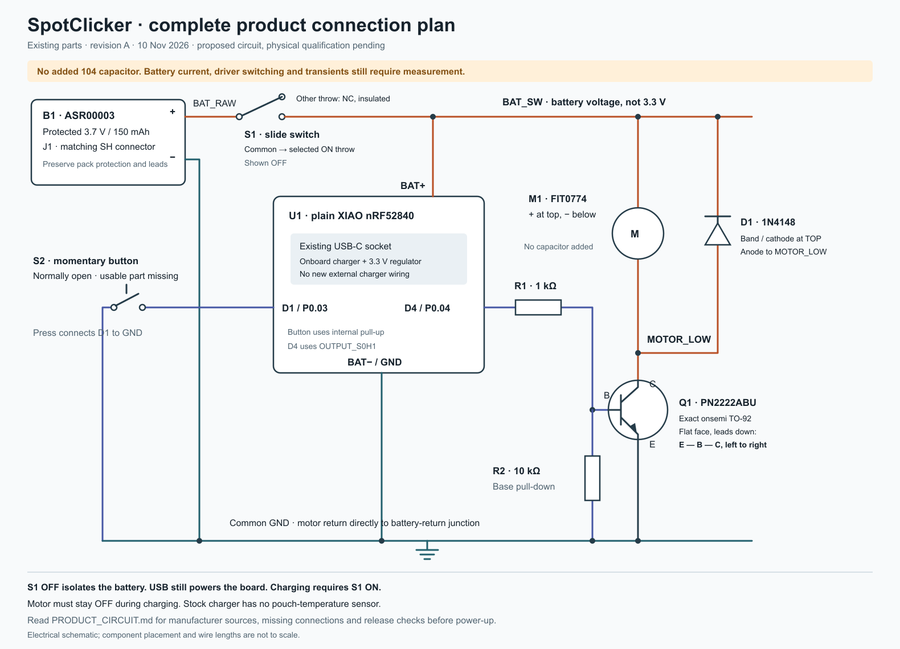

# SpotClicker product circuit — existing-parts revision A

Checked against manufacturer publications on November 10, 2026. Raj's direction: use existing parts, try without an added 104 capacitor, list unresolved limits. **Complete connection proposal; not an electrically qualified or finished product.** No new physical tests, purchases or uploads are implied.

**Latest instruction:** published specifications are accepted without re-testing. [MOTOR_RESEARCH](MOTOR_RESEARCH.md) provides exact product identification, comparator measurements and the permitted unknown-only test scope; it supersedes earlier blanket verification requests below. No noise-caused failure has been observed, and no external 104 requirement has been established for FIT0774.

[Scalable schematic](images/spotclicker-product-circuit.svg) · [Machine-readable connections](product-circuit.net.json) · [Bench driver stage](BREADBOARD_LAYOUT.md)

## Parts and connections

| Ref | Part | Status |
| --- | --- | --- |
| U1 | Plain Seeed XIAO nRF52840, 102010448 | Existing; confirm actual board revision |
| B1 | TinyCircuits ASR00003 protected 150 mAh pack | Existing; retain original protection and connector |
| S1 | C&K JS102011SAQN SPDT slide switch | Existing; needs supported mounting |
| M1 | DFRobot FIT0774 | Existing; 3 V motor-only running test passed |
| Q1 | Exact onsemi PN2222ABU | Existing; transistor switching untested |
| D1 | Existing 1N4148 | Manufacturer/order code and polarity unconfirmed |
| R1 | 1 kΩ, CF14JT1K00 | Existing; accept published value/tolerance |
| R2 | 10 kΩ, CF14JT10K0 | Existing; accept published value/tolerance |
| S2 | Normally-open momentary button | Missing usable part; cannot finish physical product without it |
| J1 | Supported battery mating connection, JST SM02B-SRSS-TB(LF)(SN) | Delivery/availability unconfirmed; bare SMT header needs a carrier |

`BAT_RAW` means protected-pack positive at the connector. `BAT_SW` means positive after S1. `MOTOR_LOW` is the collector node, **not ground**. All GND connections are common.

| Connection | Exact destination |
| --- | --- |
| B1 protected + through J1 | S1 common contact, identified against drawing and continuity test |
| S1 selected ON throw | BAT_SW |
| S1 other throw | Unconnected and insulated; never connect this throw to ground |
| BAT_SW | U1 underside BAT+ pad and M1 positive |
| B1 protected − through J1 | GND: U1 BAT−/GND, Q1 emitter and R2 ground end |
| U1 D4 / P0.04 | R1 1 kΩ input |
| R1 other end | Q1 base and R2 base end |
| R2 other end | GND |
| Q1 collector | MOTOR_LOW and M1 negative |
| D1 banded cathode | BAT_SW / M1 positive |
| D1 anode | MOTOR_LOW / M1 negative |
| S2 normally-open contacts | U1 D1 / P0.03 ↔ switch ↔ GND |
| USB-C | U1's existing USB socket only |

No added external capacitor in revision A. Keep the XIAO's and pack's factory capacitors intact. The preference to avoid a separate 104 does not mean removing onboard 100 nF parts.

With USB at top and board components facing you: D1 is second left edge pad, D4/SDA fifth left, GND second right. **Underside battery pads require the official underside view; do not mirror a top view by guess.** Q1's exact TO-92 pin order is E–B–C with flat face toward you and leads down. S1's physical terminal orientation must be matched to its manufacturer drawing; confirm common and throws unpowered. [Seeed pinout][S1], [onsemi package][S5], [C&K drawing p.4][S7].

## Power and charging behavior

| Situation | Result with this wiring |
| --- | --- |
| Battery connected, S1 ON, USB absent | Board and motor branch supplied from battery; intended portable operation |
| Battery connected, S1 OFF, USB absent | Battery positive isolated from board and motor branch |
| USB connected, S1 ON | Board powered from USB; battery connected to onboard charger; motor must be inhibited |
| USB connected, S1 OFF | Board still powered from USB; battery does not charge through the open switch |
| Servicing | Unplug USB **and physically disconnect battery** |

The charger can energize BAT_SW from USB even with S1 OFF. Therefore S1 is **battery isolation**, not isolation from every source. Motor operation while charging is excluded from revision A. Firmware must detect USB power even on a wall charger, not just a USB serial connection, and keep D4 LOW. Software inhibition is not a hardware interlock. Verify it before any battery/USB test.

Seeed's published schematic shows onboard USB/battery source selection, 3.3 V regulation and a BQ25101 charger. Its TS input uses a fixed 10 kΩ resistor, with battery-temperature sensing disabled. V1.1 and V1.2 drawings agree on these relevant blocks; the actual board revision is still to be identified. [Official schematic V1.1][S2], [current linked V1.2 schematic][S3].

Select low charging mode: P0.13 high-impedance input with no pulls (about 50 mA). Keep P0.14 LOW per Seeed's battery-reading/charging guidance. TI describes a single charger output, not an independent motor power path; extra load can prevent timely charge completion. Accept the documented charger behavior; no routine re-test of specified current, voltage or termination is requested. Investigate charging only for an actual anomaly or an identified unknown system-load interaction. [Seeed charging notes][S1], [TI charger description and termination][S4].

## What the manufacturer information establishes

| Item | Verified manufacturer fact | Remaining application check |
| --- | --- | --- |
| Motor | FIT0774: 1.5–4.2 V operating range, 3 V rated, 50 mA rated, 10 × 2.7 mm | Startup/stall current, internal brushed/brushless construction and EMI are not specified; measure behavior of actual unit. [DFRobot][S6] |
| Battery | 3.7 V nominal, 4.2 V charge cutoff; 150 mA maximum charge/discharge | Pack protection is not a 150 mA limiter: datasheet overcurrent trip is 2.8–3.5 A. Total load must stay within the cell rating independently. [TinyCircuits pp.2,5][S8] |
| Transistor | PN2222ABU package/pins; 40 V collector–emitter rating; VCE(sat) ≤0.3 V specified at IC=150 mA, IB=15 mA | That saturation guarantee does not apply to our approximately 2–3 mA base drive. Neither the current rating nor hFE proves adequate switching here. [onsemi pp.2,4][S5] |
| Chip GPIO | Standard-drive VOH is specified at 0.5 mA; high-drive VOH at 5 mA with VDD ≥2.7 V; P0.04 avoids P0.28's standard-drive recommendation | Prepared D4 uses `OUTPUT_S0H1`. This is control/base current only. Verify the output voltage under load. [Nordic GPIO][S9], [pin recommendations][S10] |
| Chip voltage | GPIO absolute range is −0.3 V to VDD+0.3 V for VDD ≤3.6 V | These are damage limits, not design targets. Check 3.3 V rail and GPIO transients with margin. [Nordic absolute maxima][S11] |
| Diode | Vishay's 1N4148 reference specifies cathode band, 150 mA average / 300 mA continuous forward current under its stated conditions | Actual diode brand/order code is unknown; do not certify it using a different manufacturer's ratings. Confirm identity, polarity and pulse/thermal suitability. [Vishay][S12] |
| Slide switch | JS series: 0.3 A at 6 VDC; actual JS102011SAQN drawing is SPDT | Nominal circuit voltage/current can fit this rating; mounting, common contact and DC motor switching behavior still need checks. [C&K pp.1,4][S7] |
| Resistors | Stackpole CF14 family is 0.25 W; J tolerance is 5% | Accept published values/tolerance. Manufacturer-authored family PDF was available through search/mirrored copy; no resistance re-test. [Stackpole source][S13] |
| Connector | SH is 1 mm pitch; TinyCircuits identifies its exact mate; JST lists 1 A for the series | Availability, assembled carrier and actual polarity are not confirmed. [JST][S14], [pack connector][S8] |

All source links below are manufacturer publications; an exact identity, unavailable specification or actual-unit measurement is explicitly left unresolved. This circuit is an engineering proposal assembled from those sources, **not a manufacturer-approved SpotClicker reference design**.

## Calculations and chosen project targets

These are our design calculations/acceptance targets, not additional manufacturer guarantees:

- Example base current at 3.3 V GPIO and 0.8 V base: `(3.3−0.8)/1000 − 0.8/10000 ≈ 2.42 mA` into Q1. This is plausible at 50 mA collector current but does not prove saturation or startup margin. Measure VCE and GPIO HIGH; do not bypass R1 or substitute a lower resistance without recalculating GPIO load.
- Even a base short to ground is limited by R1 to about `3.3/950 ≈ 3.47 mA` with a 5% low resistor. Estimated R1 dissipation is under 12 mW; R2 is under 2 mW even if its full voltage were 4.2 V. These calculations are not fault certification.
- Driver target: VCE ≤0.3 V while running, prompt reliable startup and no abnormal heat. At 50 mA and 0.3 V, collector-path dissipation is about 15 mW; transient loss must also be checked.
- Battery target: **total peak <120 mA**, including XIAO, LEDs, base current and motor starts, leaving margin below the published 150 mA maximum. A supply display reading of 50 mA running is insufficient evidence. Do not perform a direct-cell stall test.
- Charge at nominal 50 mA, below the cell's published 150 mA maximum. Use the documented charger voltage/current accuracy. No malfunction or actual excessive-charge result has been observed; ordinary manufacturer tolerances are not, by themselves, a confirmed incompatibility. An unavailable cell tolerance is an information gap, not a reason to re-test the charger ratings.
- Begin battery-only motor tests only after supply tests at the actual pack-voltage range have passed. The old 3 V result does not establish operation at a full cell.

## Avoiding the 104 capacitor

DFRobot does not publish an application circuit requiring an external 104 for FIT0774. It also does not publish transient/EMI limits that establish safe capacitor-free operation. Q1 plus the correctly connected flyback diode is the conventional low-side topology; short diode/motor loops and low-impedance ground returns matter. [ROHM low-side driver guidance][S15].

For this revision, keep the diode close to the motor connections, gently twist the insulated motor pair, place it away from the antenna/button wire, and take the motor return directly to the battery-return junction rather than along the board's ground-reference wire. These measures reduce coupling paths; they are not a substitute for measurements. A large electrolytic capacitor is not automatically equivalent to a small high-frequency suppression capacitor.

If transients, resets or interference remain unacceptable, the existing-parts/no-added-capacitor version fails qualification. Record the waveform and required remedy; do not hide the failure with retries or proceed to the enclosure. No additional capacitors or driver ICs are silently included in this design.

## What is still needed

| Need or unresolved limit | Why it matters | Existing-parts decision |
| --- | --- | --- |
| Usable normally-open button with accessible contacts | Current original contacts are inaccessible | Required for actual physical input; USB commands validate only the bench loop |
| Matching supported SH connector/carrier and secure board/motor leads | Reliable removable pack connection and strain relief | Confirm stock; bare header or loose leads do not finish the assembly |
| Diode brand/order code and actual XIAO revision | Apply the right datasheet and schematic | Confirm from bag/order/markings and board |
| Startup/total current and VCE measurements | Cell limit and driver sufficiency | Release gate; a failed result can require different hardware, which is not authorized here |
| Waveforms without added 104 | Chip/driver voltage margin and repeatable BLE operation | Release gate; no claim that the capacitor is either mandatory or unnecessary |
| Low-voltage operating cutoff | Pack protection may act around 2.4 V, below its 2.75 V discharge cutoff specification | Existing prepared firmware has no low-battery shutdown. Add and calibrate a conservative cutoff before standalone use; do not run until PCM trips |
| Battery-temperature monitoring | Stock XIAO charger does not sense pouch temperature | Remaining product limitation; firmware die temperature is not a verified battery sensor. No claim of autonomous all-temperature charging |
| Charging implementation | Use published current, voltage, tolerances and termination behavior | No routine re-test of specified behavior; investigate only an observed anomaly or unknown load interaction. Missing cell-temperature information remains a documentation gap |
| Soldered support, insulation, rigid battery separator and measured enclosure | Breadboard contacts and unsupported SMT switch are not final construction | Required fabrication work; do not compress/puncture the pack |

No additional regulator, MOSFET, current-limiter IC or external 104 is part of revision A. The research files for alternative components are not a purchase list.

## Firmware and release sequence

Prepared source compiles but is **not uploaded**: D4 motor control, high drive, `MOTOR_ENABLED = false`, D1 `INPUT_PULLUP`, debounce 25 ms, single/double/hold handling and phone-confirmed patterns. No physical driver pass exists yet. Do not turn the motor flag on simply because this document is complete.

Before standalone firmware release, implement/test: motor LOW at boot/reset; charge-only USB mode covering non-enumerating chargers; calibrated low-battery cutoff and recovery; bounded motor pulses; repeated-action handling; safe behavior on BLE loss. Current source does not yet implement the complete charge/low-voltage policy. A firmware cutoff cannot protect against a shorted transistor or miswiring; no hardware current limiter is present.

1. Unpowered inspection: identities, E/B/C, diode direction, switch routing, polarity, secure connections and shorts.
2. Existing [manual transistor test](TRANSISTOR_BENCH_TEST.md): 3 V / 100 mA limit, OFF/ON, VCE/current. No cell or chip.
3. Qualified separate-supply chip test from [BREADBOARD_LAYOUT](BREADBOARD_LAYOUT.md), still at 3 V; check phone records and motor response.
4. Characterize the motor/driver at 3.0/3.7/4.2 V using current limiting and a current probe/logger suitable for startup. Stop for current-limit dependence or a failed voltage/thermal check; do not simply raise limits. Use scope probes correctly; grounded probe clips go only to common GND.
5. Fit supported battery/switch/button; install matching protective firmware; measure battery-only startup/peak/idle current, low-voltage behavior and reconnection. Keep USB absent for portable-current qualification.
6. Check firmware charge-only USB mode by behavior/configuration. Accept published charger ratings and behavior without re-testing. Only an observed charging anomaly or an identified unknown load interaction warrants diagnostic measurements. Unpublished battery-temperature information is a documentation gap, not a demonstrated charging failure.
7. Test 10 singles, 10 doubles, 5 holds, held-at-boot, disconnect/reconnect and locked-phone use. Confirm actual saved records and distinct success/error buzzes; measure runtime.
8. Transfer proven circuit to a supported soldered carrier; measure actual assembly, fabricate enclosure, and repeat electrical/charging/action tests after closure.

Record evidence in [VALIDATION](VALIDATION.md). Only passed measurements and completed assembly can turn this proposal into the final product.

## Official source index

- S1: [Seeed XIAO nRF52840 documentation, charging and pinout](https://wiki.seeedstudio.com/XIAO_BLE/).
- S2: [Seeed XIAO nRF52840 V1.1 schematic, 2025-12-19](https://files.seeedstudio.com/wiki/XIAO-BLE/Seeed_Studio_XIAO_nRF52840_PDF.pdf), third PDF page.
- S3: [Seeed currently linked V1.2 schematic, 2026-08-28](https://files.seeedstudio.com/wiki/XIAO-BLE/Res/260828_XIAO_nRF52840.pdf), third PDF page.
- S4: [TI BQ25100/BQ25101 family datasheet](https://www.ti.com/lit/ds/symlink/bq25100.pdf), description, charging/termination and TS sections.
- S5: [onsemi PN2222A / PN2222ABU datasheet](https://www.onsemi.com/download/data-sheet/pdf/pn2222a-d.pdf), PDF pp.2–4.
- S6: [DFRobot FIT0774 product specifications](https://www.dfrobot.com/product-2297.html).
- S7: [C&K/Littelfuse JS series datasheet](https://www.ckswitches.com/media/1422/js.pdf), PDF pp.1,4.
- S8: [TinyCircuits ASR00003 battery datasheet](https://files.tinycircuits.com/Datasheets/ASR00003_150mAh.pdf), PDF pp.1,2,5,8–10; [product page](https://tinycircuits.com/products/lithium-ion-polymer-battery-3-7v-150mah).
- S9: [Nordic nRF52840 GPIO specification](https://docs.nordicsemi.com/r/bundle/ps_nrf52840/page/gpio.html).
- S10: [Nordic nRF52840 pin recommendations](https://docs.nordicsemi.com/r/bundle/ps_nrf52840/page/pin.html).
- S11: [Nordic nRF52840 absolute maximum ratings](https://docs.nordicsemi.com/r/bundle/ps_nrf52840/page/abs_max_ratings.html).
- S12: [Vishay 1N4148 datasheet](https://www.vishay.com/docs/81857/1n4148.pdf), a reference until actual diode manufacturer is confirmed.
- S13: [Stackpole CF/CFM manufacturer datasheet URL](https://www.seielect.com/catalog/sei-cf_cfm.pdf); direct access returned 403, manufacturer-authored copy available via [PDF mirror](https://www.mouser.com/datasheet/3/1099/1/SEI_CF_CFM.pdf). This is the only cited datasheet retrieved through a distributor mirror.
- S14: [JST SH series manufacturer specification](https://www.jst.co.uk/productSeries.php?pid=93).
- S15: [ROHM NPN low-side switching and protection guidance](https://techweb.rohm.com/product/transistors-diodes/transistors/27354/).

[S1]: https://wiki.seeedstudio.com/XIAO_BLE/
[S2]: https://files.seeedstudio.com/wiki/XIAO-BLE/Seeed_Studio_XIAO_nRF52840_PDF.pdf
[S3]: https://files.seeedstudio.com/wiki/XIAO-BLE/Res/260828_XIAO_nRF52840.pdf
[S4]: https://www.ti.com/lit/ds/symlink/bq25100.pdf
[S5]: https://www.onsemi.com/download/data-sheet/pdf/pn2222a-d.pdf
[S6]: https://www.dfrobot.com/product-2297.html
[S7]: https://www.ckswitches.com/media/1422/js.pdf
[S8]: https://files.tinycircuits.com/Datasheets/ASR00003_150mAh.pdf
[S9]: https://docs.nordicsemi.com/r/bundle/ps_nrf52840/page/gpio.html
[S10]: https://docs.nordicsemi.com/r/bundle/ps_nrf52840/page/pin.html
[S11]: https://docs.nordicsemi.com/r/bundle/ps_nrf52840/page/abs_max_ratings.html
[S12]: https://www.vishay.com/docs/81857/1n4148.pdf
[S13]: https://www.seielect.com/catalog/sei-cf_cfm.pdf
[S14]: https://www.jst.co.uk/productSeries.php?pid=93
[S15]: https://techweb.rohm.com/product/transistors-diodes/transistors/27354/
