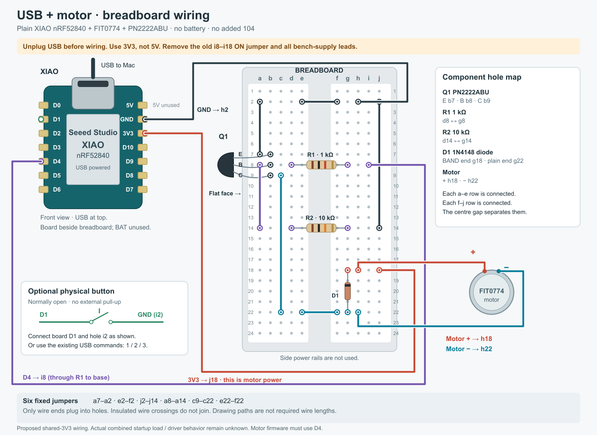

# USB-only MVP with vibration

Current direction, November 10, 2026: **USB-powered XIAO + FIT0774 motor + existing transistor driver; battery excluded.** This replaces the prior motorless USB suggestion. It is a proposed shared-3.3 V circuit, not a new physical test pass.



[Open scalable wiring diagram](images/usb-motor-breadboard.svg) · [Exact connection schedule](usb-motor-breadboard.connections.json)

## Power path and published limits

USB-C → XIAO onboard 3.3 V regulator → motor branch and board. D4 controls the motor through the PN2222ABU, not by supplying motor current from GPIO. No bench supply or battery is connected in this configuration.

DFRobot specifies FIT0774 for 1.5–4.2 V, so regulated 3.3 V is within its published range; USB/5V is not. [Official motor specifications](https://www.dfrobot.com/product-2297.html).

Seeed's published plain-XIAO V1.1/V1.2 schematics show the SGM2040-3.3 regulator and a 3.3 V/250 mA annotation. SGMICRO specifies 250 mA output, with thermal and input/output conditions applying. This is the **total shared rail**, including the board, base resistor and motor. It is not a 250 mA allowance exclusively for the motor. Actual board revision remains an identification gap; apply the matching board/regulator documentation. [Seeed schematic](https://files.seeedstudio.com/wiki/XIAO-BLE/Seeed_Studio_XIAO_nRF52840_PDF.pdf), [SGMICRO specification](https://www.sg-micro.com/product/SGM2040).

Accept these ratings without re-testing. FIT0774's actual startup current and the combined board/driver load at 3.3 V remain unpublished system quantities. Their sum must fit the rail's applicable current and thermal limits. Comparable motor figures in [MOTOR_RESEARCH](MOTOR_RESEARCH.md) are estimates for planning, not FIT0774 limits. Shared-rail coupling is also an unknown interaction; no noise failure has been observed.

## Complete connections

Unplug USB before assembling or changing wiring. Battery physically detached; battery switch/connector branch unused. Remove all bench-supply connections and any temporary base-ON jumper.

| From | To |
| --- | --- |
| Mac USB-C data cable | XIAO USB socket |
| XIAO **3V3 output** | Motor positive and diode banded cathode |
| Motor negative | PN2222ABU collector and diode anode |
| PN2222ABU emitter | XIAO GND / common ground |
| XIAO D4 | Existing 1 kΩ → transistor base |
| Transistor base | Existing 10 kΩ → common GND |
| Optional physical normally-open button | D1 ↔ button ↔ common GND; internal pull-up already implemented |

Keep exact transistor/diode pin identification from [PRODUCT_CIRCUIT](PRODUCT_CIRCUIT.md). No connection to 5V, BAT+ or BAT− pads is needed. No added external 104 is specified; suppression remains conditional on a real interaction, not a presumed failure. Route motor return to the ground junction and keep the motor/diode loop short.

If reusing the driver placement in [BREADBOARD_LAYOUT](BREADBOARD_LAYOUT.md), preserve its six fixed jumpers and component positions, remove **i8–i18**, and use **only** these three board connections: **3V3 → j18; GND → h2; D4 → i8**. Remove the old supply-positive and supply-negative leads. This is a new power configuration; do not mix it with the separate bench-supply schedule.

## Firmware and remaining unknowns

Raj explicitly requested running the motor from USB rather than returning to the separate bench-supply stage. The D4 test firmware now includes a manual `m` command. Version 2 supplied a 150 ms pulse (Raj reported very light vibration); version 3 supplied 500 ms (Raj reported no vibration). Version 4 extends the test to **10 seconds**, as requested. These changes affect duration, not supply voltage; D4 is fully ON during the test. Actual upload and command results are recorded in [BUILD_STATE](BUILD_STATE.md) and [VALIDATION](VALIDATION.md).

**Observed result:** v4 was uploaded and completed the 10-second test, then returned D4 LOW. Raj confirmed “it worked perfectly.” The board responded afterward with the phone connected/subscribed and the test-used flag retained. This establishes USB-powered vibration for this assembly; automatic feedback patterns and unmeasured electrical quantities remain separate work.

```sh
python3 scripts/clicker-usb.py s
python3 scripts/clicker-usb.py m --wait 12
```

`m` permits one pulse per boot, sends no phone action and returns D4 LOW at the duration limit. It stops early on USB serial disconnect or an `x` received in the same open session. Other input during the test is discarded. The helper releases DTR on exit/cancellation; keep it open for the full requested test. A physical USB disconnection removes power because the battery is absent.

Status reports uptime and whether the test was used. GPIO digital readback and completion logs establish software behavior, not motor voltage/current or vibration; physical vibration is established here by Raj's report of the 10-second test. Automatic phone-feedback vibration remains disabled (`MOTOR_ENABLED = false`). The motor-control pin uses `OUTPUT_S0H1` for the base resistor. The earlier short-pulse reports have no established cause and are not evidence of noise damage.

The intended product workflow is USB/physical button → BLE save/undo → phone response → motor pattern; automatic motor feedback remains pending. USB commands can substitute for the still-missing usable button. A Mac USB data connection supports both power and the existing serial helper; the phone remains the Bluetooth/GPS/storage device.

Only genuinely unknown checks remain: driver loaded VCE, FIT0774 startup/combined rail demand and actual behavior of this shared-supply assembly. No new tests of known motor voltage ratings, regulator ratings, resistor values or charging setpoints are requested.

Battery charging, low-battery cutoff and pouch-temperature concerns are outside this MVP because no battery is connected. The proposed portable battery circuit remains deferred.
