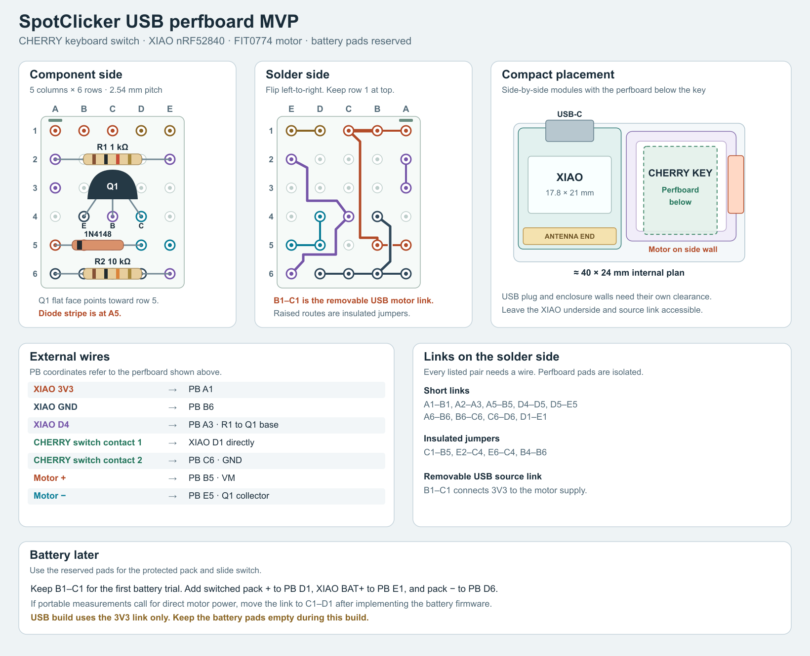

# SpotClicker USB perfboard MVP

Use your normally open **CHERRY keyboard switch** with the existing tap, double-tap and hold gestures. USB-C powers and programs the XIAO. The phone receives actions over Bluetooth. The FIT0774 motor uses the same 3V3 supply and transistor driver as the successful USB breadboard test. This is the soldered layout for the USB MVP, with a battery connection reserved for a later build.

[Zoomable wiring sheet](images/usb-perfboard-mvp.svg) · [USB breadboard test record](VALIDATION.md)

## Size and mounting

- Cut a **5-column × 6-row isolated-pad perfboard** at 2.54 mm pitch. Allow roughly **12.7 × 15.2 mm** when trimming midway between holes and keep the outer copper rings intact. Mark **A1** on both faces before soldering. On the component face, A is at the left. Flip the board left-to-right with row 1 at the top to read the solder face.
- Use the XIAO beside the key and the perfboard below the key. The drawing targets **about 40 × 24 mm internally** using a roughly 19 mm key area. Measure the actual keycap, switch terminals, transistor height, wire bends and USB plug before cutting a case. The XIAO is 17.8 × 21 mm. [Seeed board dimensions and pinout](https://wiki.seeedstudio.com/XIAO_BLE/#hardware-overview), [CHERRY MX2A reference](https://www.cherry.de/en-us/product/mx2a-blue/downloads).
- Mount the key in a rigid plate matched to its switch. Support the XIAO and perfboard in the enclosure, with the perfboard solder face accessible from the removable bottom. Space the key's metal terminals clear of the perfboard and its parts throughout key travel. Route the short button wires to the switch's two electrical terminals.
- Bond the **10 × 2.7 mm** motor to a rigid wall beside the key so the enclosure carries its vibration. Route the motor pair together and away from the XIAO antenna end opposite USB. Keep the underside BAT pads and row 1 solder links accessible. [DFRobot FIT0774 dimensions](https://www.dfrobot.com/product-2297.html), [Seeed front view and hardware files](https://wiki.seeedstudio.com/XIAO_BLE/#hardware-overview).

## Solder schedule

Fit the existing PN2222ABU, 1N4148, 1 kΩ and 10 kΩ resistors. The USB test circuit uses the diode and no added 104 capacitor. Fit the CHERRY switch and matching keycap. Use the two metal switch contacts and insulated hookup wire for the longer links and off-board connections.

| Part | Component-side pads |
| --- | --- |
| R1, 1 kΩ | A2 to E2 |
| R2, 10 kΩ | A6 to E6 |
| Q1, PN2222ABU | Emitter B4, base C4, collector D4. On this placement the flat face points toward row 5. Form the outer leads gently to match the hole spacing. |
| Flyback diode, 1N4148 | Banded cathode A5, anode D5 |

The PN2222ABU pin order is emitter, base, collector viewed from the marked flat face with the leads down. Use the part's E/B/C labels as the wiring reference. [onsemi package and pin drawing, PDF p. 2](https://www.onsemi.com/pdf/datasheet/pn2222a-d.pdf#page=2).

| Solder-side link group | Wire each listed pair |
| --- | --- |
| Short permanent links | A1–B1, A2–A3, A5–B5, D4–D5, D5–E5, A6–B6, B6–C6, C6–D6, D1–E1 |
| Insulated permanent jumpers | C1–B5, E2–C4, E6–C4, B4–B6 |
| Removable USB motor supply link | **B1–C1** |

The bottom view mirrors the column order to **E, D, C, B, A**. Solder only the endpoints of each insulated jumper. In particular, **B4–B6 crosses the motor-positive connection near B5**, so its insulation must cover the crossing. Put the removable B1–C1 link where it can be desoldered without disturbing A1–B1 or C1–B5.

| From | To |
| --- | --- |
| USB-C cable | XIAO USB-C socket |
| XIAO 3V3 | Perfboard A1 |
| XIAO GND | Perfboard B6 |
| XIAO D4 | Perfboard A3 |
| CHERRY switch contact 1 | XIAO D1 |
| CHERRY switch contact 2 | Perfboard C6 |
| FIT0774 positive lead | Perfboard B5 |
| FIT0774 negative lead | Perfboard E5 |

On the XIAO component face with USB at the top, D1 is the second pad down on the left and D4 is the fifth. GND is the second pad down on the right and 3V3 is the third. The normally open switch closes D1 to ground. The firmware supplies the pull-up and handles debounce. `Perfboard D1` is the future battery pad in the drawing. `XIAO D1` is the button GPIO. [Seeed front pinout](https://files.seeedstudio.com/wiki/XIAO-BLE/XIAO_nRF52840_front_pinout.png).

## Build and check

1. Dry-fit the key, perfboard and XIAO. Mark A1 and wire the perfboard with USB disconnected. Solder the driver, then the short links and insulated jumpers. Keep the three battery wire landings empty.
2. Before attaching the motor and XIAO, inspect the solder-side paths for bridges between the 3V3/motor-positive group, motor return, ground, and spare battery-positive group. Check that the diode stripe faces the motor-positive group. Diode mode should show one-way conduction across the installed diode. Attach the external wires and anchor them to the case so the joints do not carry cable or key force.
3. Power over USB. Check that the key sends the expected Bluetooth action for a tap, double-tap and hold. The uploaded USB test firmware has manual motor command `m` and automatic motor feedback disabled. Use the known manual test to verify the transferred motor circuit. Tune and enable feedback patterns as a separate firmware step. [USB test commands](USB_MOTOR_MVP.md).

The perfboard wiring has been checked as a design. The USB breadboard motor test is the physical result so far. The soldered assembly, switch fit and case height still need a dry-fit and first power-up.

## Battery upgrade

Preserve the USB enclosure's removable bottom and access to the XIAO underside. The protected ASR00003 has a nominal 20 × 20 × 5 mm body with published dimensional tolerances. Size the later battery compartment from the actual pack, lead exit, switch and insulating separator. Keep the pack clear of the antenna end and away from motor or key pressure. The USB assembly target covers the USB parts. [TinyCircuits pack dimensions and limits](https://tinycircuits.com/products/lithium-ion-polymer-battery-3-7v-150mah).

With power removed, add these three connections. Use the original protected pack output. Its positive lead goes through the existing slide switch, then to the reserved positive pad.

| Add later | Landing |
| --- | --- |
| Switched protected pack positive | Perfboard D1 |
| XIAO underside BAT+ | Perfboard E1 |
| Protected pack negative | Perfboard D6 |

D1–E1 already joins the switched positive landing and XIAO BAT+ landing. D6 already joins XIAO GND via B6. Leave **B1–C1** in place for the first portable build so the motor continues to use the XIAO regulator. Confirm startup demand and usable motor voltage as the battery discharges. The battery firmware needs low-voltage cutoff and charging behavior before portable use. [Seeed underside pinout](https://files.seeedstudio.com/wiki/XIAO-BLE/XIAO_nRF52840_back_pinout.png), [Seeed charging guidance](https://wiki.seeedstudio.com/XIAO_BLE/#battery-charging-current), [existing battery design constraints](BATTERY_DIRECT_WIRING.md).

If portable measurements favor powering the motor from switched battery voltage, use the alternate source position. Remove **B1–C1** and fit **C1–D1**. Populate **one** source link at a time. The alternate position needs the existing project's USB motor-inhibit policy because the charger shares the battery node. The 10-second USB test build is for battery-free testing. [Original switched-battery topology and firmware requirements](PRODUCT_CIRCUIT.md).
